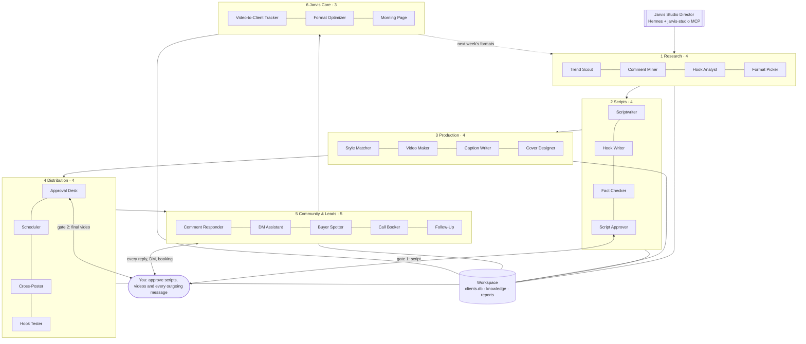

# Jarvis Studio: the 24-agent layout

This is the layout from *How 24 AI agents run an entire video studio*, adapted to what Jarvis runs on this computer. There are six modules with 4–5 agents each, one shared workspace and two human approval gates. It runs as a **loop, not a funnel**: what got views and clients this week decides next week's formats.

The agents are roles that Hermes plays using the `jarvis-studio` tools. They aren't 24 separate programs. The master prompt is [`skills/jarvis-studio-director/SKILL.md`](skills/jarvis-studio-director/SKILL.md), and each agent's brief is in [`skills/jarvis-studio-director/references/agents.md`](skills/jarvis-studio-director/references/agents.md).

## Layout



## The 24 agents, mapped to Jarvis

Status: ✅ the tool exists now · 🟡 Hermes can do it with existing tools plus judgement · ⬜ needs a new connection or tool

| Module | Agent | What it does here | Jarvis tools | Status |
|---|---|---|---|---|
| **1 Research** | Trend Scout | Finds videos in your niche that beat their own channel's average views by 3× or more. When a small account does that, it's the format, not the followers | Perplexica web search, YouTube data (yt-dlp or the YouTube Data API) | ⬜ |
| | Comment Miner | Collects questions and requests from comments on your own videos | Platform comment export or API | ⬜ |
| | Hook Analyst | Transcribes the first 3 seconds of the top videos and names the hook pattern | `video_captions` (Whisper) | 🟡 |
| | Format Picker | Picks the format for each idea: music video, performance, beat-cut edit, narrated, short | Director logic | 🟡 |
| **2 Scripts** | Scriptwriter | Writes up to 10 scripts or shot lists a week around the winning formats | Hermes LLM | 🟡 |
| | Hook Writer | Writes three hooks per script (first line plus on-screen text) | Hermes LLM | 🟡 |
| | Fact Checker | Checks every claim and marks anything it can't source | Perplexica | 🟡 |
| | Script Approver | **You.** Gate 1: nothing gets produced until you approve the script | Dashboard review queue | ⬜ |
| **3 Production** | Style Matcher | Picks look, aspect, pace and music from what performed before | `brand/brand.md` and past metrics | 🟡 |
| | Video Maker | Makes the video | `video_music_video`, `video_auto_edit`, `video_narrated`, `video_performance`, `studio_make_music`, `studio_ai_produce` | ✅ |
| | Caption Writer | Burns in captions, writes the post caption and hashtags | `video_captions`, lyrics, Hermes LLM | ✅ |
| | Cover Designer | Thumbnails and covers | Thumbnails from every video tool (Inkscape) | ✅ |
| **4 Distribution** | Approval Desk | **You.** Gate 2: the final video, caption and thumbnail wait in `review/` until you approve | Dashboard review queue | ⬜ |
| | Scheduler | Posting calendar with the best time per platform | Hermes cron | 🟡 |
| | Cross-Poster | Renders 9:16, 1:1 and 16:9 versions per platform; uploads only after approval | `video_shorts` for renders, platform upload | ✅ / ⬜ |
| | Hook Tester | Posts two hook or thumbnail variants and keeps the winner after 48 h | Platform analytics | ⬜ |
| **5 Community & Leads** | Comment Responder | Drafts replies to comments | Platform API | ⬜ |
| | DM Assistant | Drafts DM replies | Platform API | ⬜ |
| | Buyer Spotter | Flags "how much?" and "can you do this for me?" as buyers | Hermes LLM over the inbox | 🟡 |
| | Call Booker | Offers times from your calendar and sends your booking link once you approve | Calendar connector | ⬜ |
| | Follow-Up | Reminds you about buyers who went quiet after 3 days | `clients.db`, Hermes cron | 🟡 |
| **6 Jarvis Core** | Video-to-Client Tracker | Gives each video its own link, so clients are traced to the video that brought them | `clients.db` | ⬜ |
| | Format Optimizer | Every week: what worked, so make more of it | Metrics plus `reports/weekly` | 🟡 |
| | Morning Page | One page every morning: what worked, what's booked, what's waiting on you | `jarvis-studio status --today` | ⬜ |

**What changes from the video:**
- **No AI avatar.** Production uses your own footage, the studio's music and generated visuals, and nothing generates a photoreal "you" from one photo.
- **Leads agents only draft.** Every reply, DM and booking goes out only after you approve it. That follows the Jarvis safety model: sending messages always needs your OK.
- **Posting is a separate step.** It needs your platform accounts connected, and it always goes through the Approval Desk.

## What interrupts you

These are the only things that ping your phone. Everything else waits for the Morning Page.

1. **Script ready for approval** (gate 1)
2. **Video ready for approval** (gate 2), with the video, caption, thumbnail, platforms and time
3. **Off-brand check failed**: the wrong aspect, missing captions, loudness off -14 LUFS, or a style that breaks `brand.md`
4. **A buyer was spotted**, with a drafted reply and booking link waiting for your OK
5. **A tool failed twice**

## Folder structure

### Code (this repo)

```
extensions/services/jarvis-studio/
├── server.py                 MCP server: 21 tools for Hermes
├── dashboard.py              local dashboard on 127.0.0.1:7722
├── static/dashboard.html
├── studio/                   music studio (StemDeck, Guitarix, OBS, Audacity, Ardour, ACE-Step, MOSS)
│   └── video/                video studio (music videos, performance, beat-cut, shorts, narrated, captions)
├── scripts/                  ACE-Step runner, Ardour Lua action
├── agents/                   ← this layout
│   ├── README.md
│   └── skills/
│       └── jarvis-studio-director/
│           ├── SKILL.md              master prompt (Hermes skill)
│           └── references/
│               ├── agents.md         one brief per agent (24)
│               └── workspace.md      file formats: brief.yaml, review card, morning page
└── setup.sh
```

### Workspace (`~/Studio`, the system of record)

Each piece of work is one folder that moves through stages. Its `brief.yaml` holds the status, so you, the dashboard and Hermes all see the same state.

```
~/Studio/
├── brand/
│   ├── brand.md              voice, audience, niche, do/don't, colours, fonts
│   ├── voice.wav             voice to clone for narration (MOSS-TTS)
│   └── assets/               logo, intro/outro, photos of you
├── research/
│   └── 2026-W47/
│       ├── outliers.csv      video, channel, views, channel average, ratio
│       ├── hooks.md          hook patterns that worked, with examples
│       └── ideas.md          ranked ideas → Format Picker
├── pipeline/
│   ├── 1-ideas/              <slug>/brief.yaml  (status: idea)
│   ├── 2-scripts/            <slug>/script.md, hooks.md  (status: scripted)
│   ├── 3-production/         <slug>/renders/, captions/, thumbnails/  (status: producing)
│   ├── 4-review/             <slug>/review.md + final files  ← GATE 2: you approve here
│   └── 5-published/2026-11/  <slug>/post.md (links), metrics.csv
├── community/
│   ├── inbox/                comments and DMs pulled in
│   ├── drafts/               replies waiting for your OK
│   └── sent/                 what went out, and when
├── clients/
│   └── clients.db            SQLite: people, source video, stage, value, next step
├── knowledge/                notes, transcripts, past scripts (searchable index)
├── reports/
│   ├── morning/2026-11-22.md
│   └── weekly/2026-W47.md
└── logs/                     links to the jarvis-studio audit log
```

Renders still land in `~/Music/Jarvis` and `~/Videos/Jarvis`. The Video Maker links the finished files into `pipeline/3-production/<slug>/renders/`.

Create the workspace with:

```bash
mkdir -p ~/Studio/{brand/assets,research,pipeline/{1-ideas,2-scripts,3-production,4-review,5-published},community/{inbox,drafts,sent},clients,knowledge,reports/{morning,weekly},logs}
```

## Building the ⬜ parts, in order

1. **Review queue and Morning Page.** Add a `pipeline/` reader to the dashboard with Approve/Reject buttons, plus `jarvis-studio status --today`. Both gates need this first.
2. **clients.db and per-video links** for the Video-to-Client Tracker.
3. **Research data**: YouTube search and channel averages, either yt-dlp metadata or a YouTube Data API key.
4. **Platform connections** for posting, comments and DMs. Each one needs your accounts and stays behind the approval gates.
